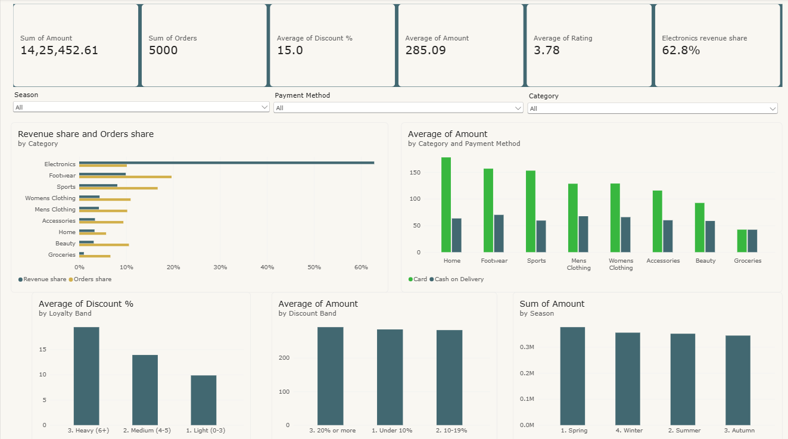
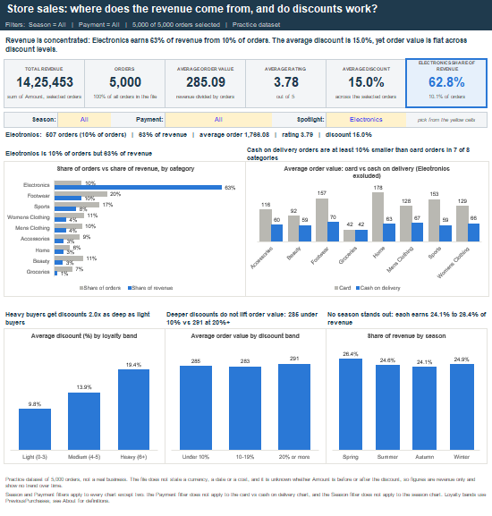

# Store sales analysis: where does the revenue come from, and do discounts work?

An SQL analysis of a 5,000-order store sales file, written in MySQL. It calculates headline KPIs, compares them across product, customer and payment groups, and checks which differences are real.

> **Status:** the SQL analysis, the Excel dashboard and the Power BI dashboard are complete.

## The question

*Which products, customers and payment methods drive the store's revenue, and do loyalty-linked discounts raise how much customers spend?*

## Data

A 5,000-row file with one row per customer order: `CustomerID`, `Age`, `Gender`, `Category`, `ItemPurchased`, `Amount`, `Season`, `PaymentMethod`, `ItemRating`, `DiscountApplied(%)`, `PreviousPurchases`. The file has no blanks or duplicate rows. The CSV is not included as a separate file, but the same 5,000 rows are on the `Data` sheet of the Excel workbook. The file does not state a currency, a date or a cost, so results are revenue only, not profit, and there is no trend over time.

It is a practice dataset, not data from a real business. Nothing here describes a real company's sales.

## Headline KPIs

| KPI | Result |
|---|---|
| Total revenue | 1,425,452.61 |
| Total orders | 5,000 |
| Average order value | 285.09 |
| Average item rating | 3.78 |
| Average discount | 15.0% |
| Share of orders discounted | 99.8% |
| Share of orders from customers with previous purchases | 99.3% |

The last two are included to show why they are **not useful** here: 4,991 of 5,000 orders carry a discount, and 4,967 customers have bought before. The analysis therefore compares discount depth and loyalty bands instead.

## Dashboard

**Power BI** - six KPI cards, three dropdown filters (season, payment method and category) and five charts, each titled with its finding.

Built in the Power BI service (the browser version) on the same 5,000 rows. Three short DAX measures (orders share, revenue share and Electronics revenue share) divide a category's total by the total of all categories. The cards match the SQL and Excel results: revenue 1,425,452.61, 5,000 orders, average order value 285.09, average rating 3.78, average discount 15.0% and Electronics 62.8% of revenue. The report file is [`store_sales_dashboard.pbix`](store_sales_dashboard.pbix); open it in Power BI Desktop.

**Excel** - the same results on one page, with six KPI cards, five charts and filters.

[`Store_Sales_Dashboard.xlsx`](Store_Sales_Dashboard.xlsx) turns the results into one page. Pick a **Season** and a **Payment** method in the yellow cells and every card and chart updates; pick a **Spotlight** category to see one category on its own. Every figure is a live formula on the 5,000-row `Data` sheet, and the totals match query 1 of the SQL file (the check is on the `About` sheet).

## Findings

**1. Revenue depends on Electronics.** Electronics is 10.1% of orders but 62.8% of revenue (895,402 of 1,425,453). The category has just four products (laptop, mobile phone, headphones, smart watch), and each one alone earns more revenue than any item outside it.

**2. Discounts follow loyalty and do not raise spending.** The average discount rises by about 2 points for each previous purchase, from 5.5% at none to about 25% at ten. Average order value is flat across discount levels: 284.62 under 10%, 282.65 at 10 to 19%, 291.42 at 20% or more. Ratings are higher at deeper discounts (3.66 to 3.93), but the deepest discounts go to the most loyal customers, so this shows an association, not a cause. The file does not say whether `Amount` is before or after the discount, so the discounts cost between 214,292 (15.0% of revenue) and 260,783 (18.3%).

**3. Cash on delivery is small and low value.** It is 19.8% of orders but 4.2% of revenue. There are no Electronics orders on cash on delivery. In every other category except Groceries, cash on delivery orders are 37% to 64% smaller than card orders.

**4. The gender gap is a product-mix effect.** Men average 460.62 per order and women 110.12. But Electronics and Men's Clothing are bought only by men, and Accessories, Beauty and Women's Clothing only by women. In the four categories bought by both (Footwear, Groceries, Home, Sports) the two groups' average order values are within 5 of each other.

**5. Season, age and ratings show no real differences.** Each season holds 24.1% to 26.4% of revenue. After adjusting for category, spend does not differ significantly by season (p = 0.59) or age band (p = 0.55). Item ratings sit between 3.69 and 3.91.

## Ideas to test (not findings)

- Review whether the loyalty discount ladder should be capped, since deeper discounts do not lift order value in this data.
- Track how much of revenue depends on four Electronics products.
- Look into the cost of serving cash on delivery orders; this data has no cost field, so it cannot be answered here.

## Method notes

- Order value comparisons are made within category, because Electronics orders (about 500 to 3,000) are much larger than anything else.
- Loyalty bands: light (0 to 3 previous purchases), medium (4 to 5), heavy (6 or more). Discount bands: under 10%, 10 to 19%, 20% or more. Age bands: 20 to 29, 30 to 39, 40 to 49, 50 to 59, 60 to 70.
- Results were reproduced independently in DuckDB and in Python (pandas).

## Limitations

- One snapshot with no dates, so no growth or trend.
- No cost data, so revenue only.
- Whether `Amount` is before or after the discount is unknown.
- Practice data: the tidy structure (one row per customer, an even gender split, products tied to gender) is not typical of real sales.

## Files

| File | What it is |
|---|---|
| [`PortfolioProject_Store_Sales.sql`](PortfolioProject_Store_Sales.sql) | 12 MySQL queries: seven KPIs, then comparisons by category, item, season, age, gender, payment, loyalty and discount |
| [`Store_Sales_Dashboard.xlsx`](Store_Sales_Dashboard.xlsx) | One-page Excel dashboard with filters, plus `About` (definitions, check against the SQL), `Dash_Data` (formulas) and `Data` (the 5,000 rows) |
| [`store_sales_dashboard.png`](store_sales_dashboard.png) | Picture of the Excel dashboard shown above |
| [`powerbi_dashboard.png`](powerbi_dashboard.png) | Picture of the Power BI page shown above |
| [`store_sales_dashboard.pbix`](store_sales_dashboard.pbix) | The Power BI report with its data (open in Power BI Desktop; GitHub cannot preview it) |

## How to run

1. In MySQL Workbench, create the database and import your copy of the sales file into a table called `Sales` (Table Data Import Wizard): `CREATE DATABASE IF NOT EXISTS Store_sales;`
2. Open `PortfolioProject_Store_Sales.sql` and run each query on its own. The first query should return 1425452.61, 5000, 285.09, 3.78, 15.0, 99.8 and 99.3.
